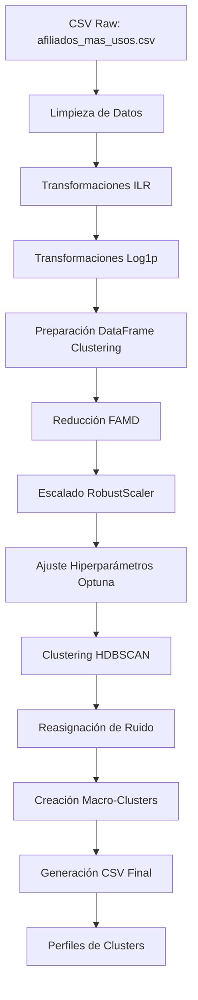
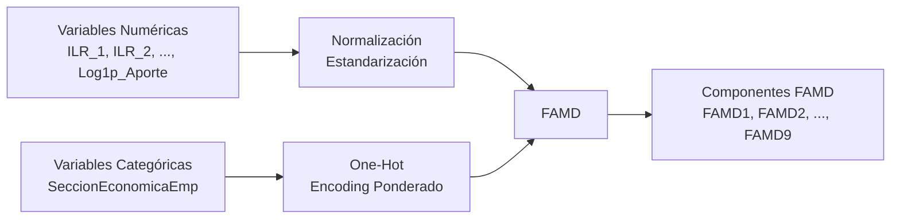
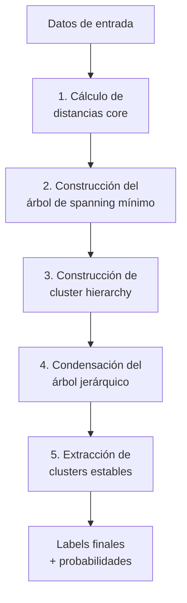

# 📊 Proyecto de Clustering de Empresas con HDBSCAN

Este repositorio contiene un modelo de **machine learning** para la **clasificación no supervisada (clustering) de empresas** utilizando el algoritmo **HDBSCAN** *(Hierarchical Density-Based Spatial Clustering of Applications with Noise)*. El modelo procesa datos de aproximadamente **54,000 empresas** afiliadas, aplicando transformaciones de datos avanzadas y técnicas de reducción de dimensionalidad antes de la clusterización.

---

## 📁 Estructura del Proyecto

```
Proyecto_Clustering/
├── Clustering HDBSCAN/
│   ├── Modelo/
│   │   ├── Pipeline.ipynb          # Notebook principal del modelo
│   │   ├── afiliados_mas_usos.csv  # Datos de entrada (~54,000 empresas)
│   │   └── outputs/                # Resultados del modelo
│   │       ├── 01_clean/           # Datos limpios
│   │       ├── 02_analysis/        # Análisis y ajuste de hiperparámetros
│   │       └── 03_Resultados/      # CSV clusterizado y perfiles
│   └── Query T-SQL/
│       └── Maestro_Clustering.sql  # Consulta SQL para obtener los datos
├── Pruebas/                        # Scripts de pruebas previas
│   ├── pipeline_unificado.py
│   ├── clustering_reduccion_dimensional.py
│   ├── clean_csv.py
│   ├── analisis.py
│   └── pruebas_iniciales/
└── README.md                       # Este archivo
```

---

## 📂 Descripción de Carpetas

### 🔹 `Clustering HDBSCAN/`

Este directorio contiene el modelo consolidado de clustering.

#### 📌 `Modelo/`
Contiene el pipeline de machine learning principal:

| Archivo/Carpeta | Descripción |
|-----------------|-------------|
| `Pipeline.ipynb` | **Notebook principal** con todo el flujo de procesamiento, transformaciones y clusterización |
| `afiliados_mas_usos.csv` | Dataset de entrada con datos de ~54,000 empresas |
| `outputs/` | Carpeta donde se almacenan todos los resultados |

##### 📂 `outputs/`

| Subcarpeta | Contenido |
|------------|-----------|
| `01_clean/` | CSV limpio sin caracteres especiales, CSV con datos transformados (ILR + Log1p) y CSV escalado con componentes FAMD |
| `02_analysis/` | Resumen estadístico (`data_summary.xlsx`), gráficos de correlación (heatmap y pairplot), hiperparámetros óptimos de HDBSCAN y archivos de estabilidad |
| `03_Resultados/` | **CSV final clusterizado** con etiquetas de cluster y macro-cluster, perfiles estadísticos por cluster (`perfil_clusters.xlsx`) y perfiles por macro-cluster (`perfil_macro_clusters.xlsx`) |

También se generan archivos `.log` con el registro detallado de cada ejecución del pipeline.

---

#### 📌 `Query T-SQL/`

Contiene la consulta SQL que se ejecuta en **SQL Server** para obtener la tabla maestra que alimenta el modelo.

| Archivo | Descripción |
|---------|-------------|
| `Maestro_Clustering.sql` | Consulta que extrae y agrega datos de afiliados, aportes y uso de servicios desde las tablas corporativas |

##### Estructura de la consulta:
1. **AfiliadosAgrupados**: Agrupa afiliados por empresa y período, calculando distribuciones por género, tarifa y edad
2. **PromediosAfiliados**: Calcula promedios anuales (últimos 12 meses) por empresa
3. **SeccionUnica**: Obtiene la sección económica vigente del último período
4. **Aportes**: Calcula el promedio de aportes pagados por empresa
5. **UsoServiciosAgrupados** / **PromediosUsos**: Agrega y promedia el uso de servicios (Cultura, Educación, Salud, Empleo)
6. **Maestro**: Une todas las CTEs y calcula porcentajes de distribución

---

### 🔹 `Pruebas/`

Contiene versiones previas y scripts de experimentación utilizados durante el desarrollo del modelo. Estos archivos documentan el proceso iterativo de construcción del pipeline final.

| Archivo | Descripción |
|---------|-------------|
| `pipeline_unificado.py` | Versión unificada del pipeline en Python puro |
| `clustering_reduccion_dimensional.py` | Experimentos con técnicas de reducción de dimensionalidad |
| `clean_csv.py` | Funciones de limpieza de CSV |
| `analisis.py` | Funciones de análisis exploratorio |
| `pruebas_iniciales/` | Carpeta con los primeros prototipos y experimentos |

---

## 🔬 Flujo del Pipeline (`Pipeline.ipynb`)

El notebook ejecuta un flujo secuencial de procesamiento. A continuación se explica cada etapa y función:

### 📋 Diagrama General del Flujo



---

## 🧹 1. Limpieza de Datos

### **`detect_csv_separator(file_path)`**
Detecta automáticamente el separador del CSV (`,` o `;`) analizando las primeras líneas del archivo.

**Parámetros:**
- `file_path` (str): Ruta del archivo CSV a analizar

**Retorna:** 
- El caracter separador detectado (por defecto `;` si no se puede determinar)

---

### **`clean_csv_file(input_file, output_file)`**
Normaliza y limpia el archivo CSV de entrada:
- Detecta el separador automáticamente
- Elimina el BOM (Byte Order Mark) si está presente
- Limpia espacios extra y caracteres especiales
- Asegura que todas las filas tengan el número correcto de columnas
- Escribe el CSV limpio con separador `;`

**Parámetros:**
- `input_file` (str): Ruta del CSV de entrada
- `output_file` (str): Ruta donde se guardará el CSV limpio

---

### **`cargar_y_tipear(path_csv, sep)`**
Lee el CSV limpio y convierte las columnas numéricas al tipo `float`, mientras mantiene las columnas de texto como `string`.

**Parámetros:**
- `path_csv` (str): Ruta del CSV limpio
- `sep` (str): Separador del CSV

**Retorna:**
- DataFrame con columnas correctamente tipadas

---

## 🔗 2. Asegurar Índices

### **`ensure_row_id(df, id_col, as_index)`**
Crea una columna `RowID` con un identificador único y estable para cada fila. Esto es **fundamental** para mantener la trazabilidad durante todas las transformaciones.

**Parámetros:**
- `df` (DataFrame): DataFrame de entrada
- `id_col` (str): Nombre de la columna ID (default: `"RowID"`)
- `as_index` (bool): Si se debe establecer como índice (default: `True`)

**Retorna:**
- DataFrame con el RowID asegurado

> [!IMPORTANT]
> El `RowID` se preserva a lo largo de todo el pipeline para poder asignar las etiquetas de cluster al dataset original.

---

## 📐 3. Transformación ILR (Isometric Log-Ratio)

### ¿Por qué usar ILR?

Las variables composicionales son aquellas cuyos valores suman una constante (como el 100%). Por ejemplo:
- `PorcentajeFemenino + PorcentajeMasculino + PorcentajeDesconocido = 100%`

Esto genera **redundancia**: si se conocen dos valores, el tercero se puede calcular. La transformación **ILR** resuelve esto:
- Reduce la dimensionalidad eliminando la redundancia
- Transforma datos del simplex a un espacio euclidiano estándar
- Genera **D-1** componentes a partir de **D** variables composicionales

### Bloques Composicionales Definidos

```python
BLOCKS = {
    "GENERO": ["PorcentajeFemenino","PorcentajeMasculino","PorcentajeDesconocido"],  # 3 → 2 ILR
    "TARIFA": ["PorcentajeTarifaA","PorcentajeTarifaB","PorcentajeTarifaC"],         # 3 → 2 ILR
    "EDAD":   ["PorcentajeJovenes","PorcentajeAdultoJoven","PorcentajeAdulto","PorcentajeAdultoMayor"]  # 4 → 3 ILR
}
```

### Funciones Auxiliares ILR

#### **`closure(x)`**
Cierre composicional: normaliza un vector a suma 1.

#### **`multiplicative_zero_replacement(row, tiny)`**
Reemplaza valores cero de forma multiplicativa, preservando la suma original. Necesario porque `log(0)` no está definido.

**Parámetros:**
- `row` (array): Vector de valores composicionales
- `tiny` (float): Valor pequeño para reemplazo (default: `1e-6`)

#### **`ilr_pivot(x)`**
Calcula las coordenadas ILR (pivot coordinates) usando la fórmula:

$$y_j = \sqrt{\frac{j}{j+1}} \cdot \ln\left(\frac{g(x_1...x_j)}{x_{j+1}}\right)$$

donde $g$ es la media geométrica.

---

### **`compute_block_ilr(df, block_cols, block_name)`**
Función principal que aplica el pipeline composicional completo a un bloque:
1. Reemplazo multiplicativo de ceros
2. Cierre (normalización a suma 1)
3. Transformación ILR

**Parámetros:**
- `df` (DataFrame): DataFrame con los datos
- `block_cols` (List[str]): Lista de columnas del bloque
- `block_name` (str): Nombre del bloque (ej: `"GENERO"`)

**Retorna:**
- DataFrame con columnas `{block_name}_ILR_1`, `{block_name}_ILR_2`, etc.

---

## 📊 4. Transformación Log1p

### ¿Por qué usar Log1p?

Las variables como `TotalAfiliados`, `Aporte` y `TotalUsos` tienen distribuciones muy **asimétricas** (muchas empresas pequeñas, pocas muy grandes). La transformación `log(1+x)`:
- Comprime el rango de valores
- Reduce el efecto de outliers extremos
- Armoniza con las transformaciones ILR (también logarítmicas)

### **`apply_log1p_transformations(df)`**
Crea las siguientes columnas transformadas:
- `Log1p_TotalAfiliados = log(1 + TotalAfiliados)`
- `Log1p_Aporte = log(1 + Aporte)`
- `Log1p_IntensidadUsos = log(1 + TotalUsos / max(TotalAfiliados, 1))`

**Parámetros:**
- `df` (DataFrame): DataFrame con las columnas originales

**Retorna:**
- DataFrame con las nuevas columnas Log1p añadidas

> [!TIP]
> La columna `Log1p_IntensidadUsos` normaliza los usos por tamaño de empresa, permitiendo comparar la "intensidad de uso" entre empresas de diferentes tamaños.

---

## 🎯 5. Preparación del DataFrame para Clustering

### **`preparar_df_cluster(df)`**
Selecciona y prepara las columnas finales para el análisis FAMD:
- Columnas ILR generadas
- Columnas Log1p generadas
- Columna categórica `SeccionEconomicaEmp`

**Parámetros:**
- `df` (DataFrame): DataFrame transformado

**Retorna:**
- DataFrame con solo las columnas relevantes para clustering (11 columnas típicamente)

---

## 📈 6. Resumen Estadístico

### **`resumen_numericas_en_columnas(df_num)`**
Calcula estadísticas descriptivas por columna numérica: count, mean, std, min, percentiles (25%, 50%, 75%), max, valores faltantes, ceros.

### **`resumen_categoricas(df, cat_cols)`**
Calcula estadísticas para columnas categóricas: total registros, valores únicos, moda, frecuencia de moda.

### **`save_full_summary_to_excel(df, categorical_cols, output_dir)`**
Guarda ambos resúmenes en un archivo Excel (`data_summary.xlsx`) con dos hojas.

---

## 📉 7. Reducción de Dimensionalidad con FAMD

### ¿Qué es FAMD (Factor Analysis of Mixed Data)?

**FAMD** es una técnica de reducción de dimensionalidad específicamente diseñada para trabajar con **datasets que contienen variables numéricas y categóricas simultáneamente**. Es la combinación de:

- **PCA (Principal Component Analysis)**: Para las variables numéricas
- **MCA (Multiple Correspondence Analysis)**: Para las variables categóricas

### ¿Por qué usar FAMD en este proyecto?

1. **Datos mixtos**: El dataset contiene 10 variables numéricas (ILR + Log1p) y 1 variable categórica (`SeccionEconomicaEmp` con ~20 categorías)
2. **Reducción de ruido**: FAMD extrae las direcciones de máxima varianza, descartando el ruido
3. **Desacoplamiento**: Las nuevas dimensiones (componentes FAMD) son **ortogonales** (no correlacionadas), lo cual mejora el rendimiento de HDBSCAN
4. **Preparación para clustering**: Algoritmos basados en densidad funcionan mejor en espacios de menor dimensionalidad

### Diagrama conceptual de FAMD



### Cómo funciona internamente

1. **Para variables numéricas**: Se normalizan (media 0, varianza 1) y se aplica PCA
2. **Para variables categóricas**: Se aplica un encoding similar a one-hot, pero ponderado por la frecuencia de cada categoría (MCA)
3. **Combinación**: Ambos tipos de variables se combinan en una matriz unificada
4. **Descomposición SVD**: Se extraen los autovalores y autovectores principales
5. **Varianza explicada**: Cada componente explica un porcentaje de la varianza total

### **`reduce_dimensionality_famd(df, categorical_col, n_components, random_state)`**

**Parámetros:**
| Parámetro | Tipo | Descripción |
|-----------|------|-------------|
| `df` | DataFrame | DataFrame con columnas numéricas y categóricas |
| `categorical_col` | str | Nombre de la columna categórica (ej: `"SeccionEconomicaEmp"`) |
| `n_components` | int | Número de componentes a retener (default: `9`) |
| `random_state` | int | Semilla para reproducibilidad |

**Funcionamiento paso a paso:**
1. Identifica columnas numéricas y la columna categórica
2. Limpia filas con NaN/Inf (las excluye del análisis)
3. Ajusta el modelo FAMD con **todos los componentes posibles** para calcular autovalores
4. Calcula la **varianza explicada acumulada** por cada componente
5. Verifica que los `n_components` solicitados expliquen al menos el **90% de la varianza**
6. Re-ajusta el modelo final con los `n_components` solicitados
7. Retorna DataFrame con componentes `FAMD1`, `FAMD2`, ..., `FAMDn`

### Ejemplo de varianza explicada (output real)

| Componente | Autovalor | % Varianza | % Acumulado |
|------------|-----------|------------|-------------|
| FAMD1 | 2.367 | 12.14% | 12.14% |
| FAMD2 | 1.453 | 7.45% | 19.59% |
| FAMD3 | 1.350 | 6.93% | 26.51% |
| FAMD4 | 0.973 | 4.99% | 31.50% |
| FAMD5 | 0.911 | 4.67% | 36.17% |
| FAMD6 | 0.823 | 4.22% | 40.39% |
| FAMD7 | 0.775 | 3.97% | 44.37% |
| FAMD8 | 0.735 | 3.77% | 48.14% |
| FAMD9 | 0.602 | 3.09% | **51.22%** |
| ... | ... | ... | ... |
| Total 9 comp. | - | - | **~90%** |

> [!NOTE]
> El modelo actual retiene **9 componentes FAMD** que explican aproximadamente el **90%** de la varianza total. Esto significa que se conserva la mayor parte de la información relevante mientras se reduce de 11 a 9 dimensiones.

### Alternativas a FAMD consideradas

| Técnica | Pros | Contras | Decisión |
|---------|------|---------|----------|
| **FAMD** | Maneja mixto, lineal, rápido | Asume linealidad | ✅ **Elegida** |
| One-Hot + PCA | Simple, estándar | Explosión dimensional con muchas categorías | ❌ |
| One-Hot + UMAP | Captura no-linealidad | Lento, sensible a hiperparámetros | ❌ |
| MCA puro | Para solo categóricas | No maneja numéricas | ❌ |

---

### **t-SNE (Opcional, para visualización)**

### **`reduce_dimensionality_tsne(df_scaled, n_components, random_state, perplexity, n_iter)`**

Reduce a 2 o 3 dimensiones **solo para visualización** (no para clustering, ya que no preserva distancias globales).

**Parámetros:**
- `df_scaled`: DataFrame escalado
- `n_components` (int): 2 o 3 dimensiones
- `perplexity` (int): Relacionado con el tamaño de vecindario (default: `30`)
- `n_iter` (int): Iteraciones de optimización (default: `1000`)

---

## ⚖️ 8. Escalado de Datos

### **`scale_data(df)`**
Aplica **RobustScaler** a todas las columnas numéricas.

**¿Por qué RobustScaler?**
- Usa la mediana y el rango intercuartílico (IQR) en lugar de media y desviación estándar
- Es robusto ante outliers (empresas muy grandes no distorsionan el escalado)
- Adecuado para datos con distribuciones asimétricas

**Retorna:**
- DataFrame con valores escalados y mismo índice

---

## 🔧 9. Ajuste de Hiperparámetros con Optuna

### ¿Qué es Optuna?

**Optuna** es un framework de optimización de hiperparámetros que utiliza algoritmos avanzados como **TPE (Tree-structured Parzen Estimator)** para explorar eficientemente el espacio de búsqueda. A diferencia de Grid Search o Random Search, Optuna:

- Aprende de evaluaciones anteriores para enfocarse en regiones prometedoras
- Permite definir funciones objetivo complejas (multi-criterio)
- Soporta poda temprana de trials poco prometedores
- Persiste los resultados en bases de datos SQLite

---

### Estructura de almacenamiento de hiperparámetros

```
outputs/
└── 02_analysis/
    └── HiperParametros_Maestro_ajustpersist/
        ├── best_hdbscan_Maestro_ajustpersist.json   # ← Mejores parámetros (JSON)
        └── hdbscan_tuning_Maestro_ajustpersist.db   # ← Base de datos Optuna (SQLite)
```

#### Contenido del archivo JSON de hiperparámetros

El archivo `best_hdbscan_Maestro_ajustpersist.json` contiene los mejores parámetros encontrados:

```json
{
  "min_cluster_size": 198,
  "min_samples": 19,
  "cluster_selection_epsilon": 0.39980276970238043,
  "metric": "euclidean",
  "mean_prob": 0.8584904114246067,
  "median_persist": 0.1484344559080169,
  "noise_pct": 19.864509680524193,
  "n_clusters": 37,
  "optuna_value": 0.1776796614740942,
  "trials": 400,
  "elapsed_sec": 9787.71,
  "cluster_selection_method": "eom"
}
```

| Campo | Descripción |
|-------|-------------|
| `min_cluster_size` | Hiperparámetro: Tamaño mínimo de cluster encontrado como óptimo |
| `min_samples` | Hiperparámetro: Puntos mínimos para considerar un punto como núcleo |
| `cluster_selection_epsilon` | Hiperparámetro: Umbral de fusión de clusters |
| `metric` | Hiperparámetro: Métrica de distancia óptima |
| `mean_prob` | Métrica: Probabilidad media de pertenencia lograda (0.86 = 86%) |
| `median_persist` | Métrica: Persistencia mediana de los clusters |
| `noise_pct` | Métrica: Porcentaje de ruido (19.9% ≈ 20% objetivo) |
| `n_clusters` | Resultado: Número de clusters generados |
| `optuna_value` | Score compuesto del mejor trial |
| `trials` | Total de combinaciones evaluadas |
| `elapsed_sec` | Tiempo total de optimización (segundos) |

---

### **`_eval_hdbscan_once(...)`**

Función interna que entrena HDBSCAN **una sola vez** con una combinación de hiperparámetros y calcula métricas:

| Métrica | Descripción | Rango |
|---------|-------------|-------|
| `mean_prob` | Probabilidad media de pertenencia a cluster | 0.0 - 1.0 |
| `median_persist` | Mediana ponderada de persistencia de clusters | 0.0 - 1.0 |
| `noise_pct` | Porcentaje de puntos clasificados como ruido | 0% - 100% |
| `n_clusters` | Número de clusters encontrados (excluyendo ruido) | ≥ 0 |

---

### **`tune_hdbscan_optuna(...)`**

Función principal que optimiza los hiperparámetros de HDBSCAN.

**Parámetros de la función:**

| Parámetro | Descripción | Default |
|-----------|-------------|---------|
| `X` | Matriz de datos escalados (numpy array) | - |
| `n_trials` | Número de iteraciones/combinaciones a evaluar | `120` |
| `study_name` | Nombre identificador del estudio Optuna | `"hdbscan_tpe_comfama"` |
| `storage` | Ruta de base de datos SQLite para persistencia | `None` |
| `save_best_to` | Ruta donde guardar el JSON con mejores parámetros | `None` |
| `target_min_mean_prob` | Meta mínima de probabilidad media | `0.80` |
| `target_min_persist` | Meta mínima de persistencia | `0.30` |
| `target_max_noise` | Meta máxima de ruido (%) | `20.0` |
| `target_min_clusters` | Mínimo deseado de clusters | `10` |
| `target_max_clusters` | Máximo deseado de clusters | `50` |

---

### Espacio de búsqueda de hiperparámetros

Optuna explora el siguiente espacio:

```python
# Tamaño mínimo de cluster (proporcional al dataset)
frac_mcs = trial.suggest_float("frac_min_cluster_size", 0.0003, 0.018, log=True)
min_cluster_size = max(10, int(frac_mcs * N))  # Entre 0.03% y 1.8% del dataset

# Puntos mínimos para núcleo (proporción de min_cluster_size)
ms_ratio = trial.suggest_float("min_samples_ratio", 0.1, 0.8)
min_samples = max(5, int(ms_ratio * min_cluster_size))

# Umbral de fusión de clusters
cluster_selection_epsilon = trial.suggest_float("cluster_selection_epsilon", 0.0, 0.4)

# Métrica de distancia
metric = trial.suggest_categorical("metric", ["euclidean", "manhattan"])
```

---

### 🎯 El Score Compuesto: Explicación Detallada

El **score compuesto** es una función objetivo diseñada específicamente para este problema de negocio. Define **qué priorizamos** en un buen resultado de clustering.

#### Fórmula completa del score:

```python
score = 0.0

# 1) PROTAGONISTA: Persistencia mediana (peso = 1.0)
score += 1.0 * median_persist

# 2) PENALIZACIÓN por baja probabilidad (peso = -1.5)
if mean_prob < target_min_mean_prob:  # target = 0.80
    deficit = target_min_mean_prob - mean_prob
    score -= 1.5 * deficit

# 3) BONUS por alta probabilidad (peso = +0.1)
if mean_prob >= target_min_mean_prob:
    score += 0.1 * min(1.0, (mean_prob - target_min_mean_prob) / (1.0 - target_min_mean_prob))

# 4) PENALIZACIÓN por exceso de ruido (peso = -0.02)
if noise_pct > target_max_noise:  # target = 20%
    score -= 0.02 * (noise_pct - target_max_noise)

# 5) PENALIZACIÓN por pocos clusters (peso = -0.01)
if n_clusters < target_min_clusters:  # target = 10
    score -= 0.01 * (target_min_clusters - n_clusters)

# 6) PENALIZACIÓN por demasiados clusters (peso = -0.02)
if n_clusters > target_max_clusters:  # target = 50
    score -= 0.02 * (n_clusters - target_max_clusters)
```

#### ¿Qué significa cada componente?

| Componente | Peso | Prioridad | ¿Por qué? |
|------------|------|-----------|----------|
| **Persistencia mediana** | +1.0 | 🥇 **MÁXIMA** | Clusters estables y bien definidos en la jerarquía |
| **Déficit de probabilidad** | -1.5 | 🥈 Alta | Si los puntos no "confían" en su cluster, la asignación es débil |
| **Bonus probabilidad** | +0.1 | Media | Pequeño bonus por superar el umbral |
| **Exceso de ruido** | -0.02 | 🥉 Baja | Demasiado ruido dificulta el análisis, pero es tolerable |
| **Pocos clusters** | -0.01 | Baja | Queremos granularidad mínima |
| **Demasiados clusters** | -0.02 | Baja | Evitar fragmentación excesiva |

#### ¿Por qué la persistencia tiene la máxima prioridad?

La **persistencia de un cluster** mide cuánto "sobrevive" ese cluster en diferentes niveles de la jerarquía de HDBSCAN. Un cluster con alta persistencia:
- Es **estructuralmente robusto**: no desaparece con pequeños cambios
- Tiene **fronteras bien definidas** respecto a otros clusters
- Representa un grupo **genuinamente denso** en el espacio de features

Por esta razón, se le asigna el coeficiente más alto (+1.0), priorizando soluciones con clusters estables.

#### Ejemplo de cálculo

Con los valores del mejor trial:
- `median_persist = 0.148`
- `mean_prob = 0.858` (> 0.80 ✅)
- `noise_pct = 19.86%` (< 20% ✅)
- `n_clusters = 37` (entre 10 y 50 ✅)

```
score = 1.0 × 0.148                           = 0.148
      + 0.1 × (0.858 - 0.80) / (1.0 - 0.80)   = 0.148 + 0.029 = 0.177
      (sin penalizaciones porque todo está dentro de metas)
      
optuna_value ≈ 0.177 ✅
```

---

### Retorno de la función

**Retorna:**
- `best_params` (dict): Diccionario con los mejores hiperparámetros encontrados
- `study` (optuna.Study): Objeto Study de Optuna con historial completo de trials

> [!TIP]
> Si se desea re-ejecutar la optimización con diferentes metas, se modifica los parámetros `target_*` de la función. Por ejemplo, si se quieren menos clusters, se reduce `target_max_clusters`.

---

## 🎯 10. Clustering con HDBSCAN

### ¿Qué es HDBSCAN?

**HDBSCAN** (Hierarchical Density-Based Spatial Clustering of Applications with Noise) es un algoritmo de clustering que:

- **Detecta clusters de forma arbitraria** (no asume formas esféricas como K-Means)
- **Maneja ruido automáticamente** (puntos aislados se marcan como -1)
- **No requiere especificar el número de clusters** (lo determina automáticamente)
- **Es jerárquico**: construye una jerarquía de clusters y selecciona los más estables

### ¿Por qué HDBSCAN es ideal para este dataset?

| Característica del dataset | Por qué HDBSCAN es adecuado |
|---------------------------|-----------------------------|
| **~54,000 empresas** | HDBSCAN tiene complejidad O(n log n) con KD-trees, eficiente para datasets grandes |
| **Densidades variables** | Detecta clusters de diferentes densidades (empresas grandes vs pequeñas) |
| **Outliers esperados** | Clasifica automáticamente empresas atípicas como ruido |
| **No se sabe cuántos clusters hay** | HDBSCAN encuentra el número "natural" de clusters |
| **Formas no esféricas** | Puede detectar clusters con formas complejas |

### Diagrama del funcionamiento de HDBSCAN



### Comparación con otros algoritmos

| Algoritmo | K a priori | Maneja ruido | Formas arbitrarias | Velocidad ~54K | Decisión |
|-----------|------------|--------------|-------------------|----------------|----------|
| **K-Means** | ✅ Requerido | ❌ No | ❌ Solo esféricas | ⚡ Muy rápido | ❌ |
| **DBSCAN** | ❌ No | ✅ Sí | ✅ Sí | ⚡ Rápido | ❌ Sensible a eps |
| **HDBSCAN** | ❌ No | ✅ Sí | ✅ Sí | ⚡ Rápido | ✅ **Elegido** |
| **Agglomerative** | ✅ Requerido | ❌ No | ✅ Sí | 🐢 Lento O(n²) | ❌ |
| **OPTICS** | ❌ No | ✅ Sí | ✅ Sí | 🐢 Más lento | ❌ |

---

### **`apply_hdbscan_clustering(...)`**

Aplica el algoritmo HDBSCAN a los datos escalados y calcula métricas de calidad.

---

### Parámetros de HDBSCAN: Explicación detallada

#### **`min_cluster_size`**

**¿Qué es?** El número mínimo de puntos para que un grupo se considere un cluster.

**Efecto:**
- Valores **bajos** (ej: 20): Muchos clusters pequeños, más granularidad
- Valores **altos** (ej: 500): Pocos clusters grandes, menos ruido

**En este proyecto:** Se ajusta como fracción del dataset (0.03% - 1.8%), típicamente resultando en valores entre 15-970.

#### **`min_samples`**

**¿Qué es?** El número de puntos en la vecindad de un punto para que se considere un "punto núcleo".

**Efecto:**
- Valores **bajos**: Más tolerante, menos puntos como ruido
- Valores **altos**: Más conservador, más puntos aislados serán ruido

**Regla general:** `min_samples ≤ min_cluster_size`. En este proyecto se define como un ratio (10%-80%) de `min_cluster_size`.

#### **`metric`**

**¿Qué es?** La función de distancia para medir similitud entre puntos.

| Métrica | Fórmula | Características |
|---------|---------|----------------|
| `euclidean` | $\sqrt{\sum(x_i - y_i)^2}$ | Sensible a escalas, buena para datos normalizados |
| `manhattan` | $\sum{ \lvert{x_i - y_i}\rvert }$ | Más robusta a outliers, mejor en alta dimensionalidad |

#### **`cluster_selection_method`**

**¿Qué es?** Cómo HDBSCAN selecciona los clusters finales del árbol jerárquico.

| Método | Descripción |
|--------|-------------|
| `"eom"` (Excess of Mass) | Favorece clusters **más estables/persistentes**. Default recomendado |
| `"leaf"` | Selecciona los clusters más **granulares** (hojas del árbol) |

#### **`cluster_selection_epsilon`**

**¿Qué es?** Umbral de distancia mínima para considerar que dos clusters son distintos.

**Efecto:**
- `epsilon = 0`: Sin fusión, máxima granularidad
- `epsilon > 0`: Clusters cercanos se fusionan, menos clusters totales

---

### Métricas de calidad calculadas

| Métrica | Rango | Interpretación |
|---------|-------|----------------|
| **Silhouette Score** | -1 a 1 | Mide cohesión interna vs separación. **Mayor es mejor**. >0.5 = buena estructura |
| **Calinski-Harabasz** | ≥ 0 | Ratio varianza inter/intra cluster. **Mayor es mejor** |
| **Davies-Bouldin** | ≥ 0 | Similitud promedio entre clusters. **Menor es mejor** (<1 es bueno) |
| **Mean Probability** | 0 a 1 | Confianza promedio en la asignación. **Mayor es mejor**. >0.8 es excelente |
| **Median Persistence** | 0 a 1 | Estabilidad de clusters en la jerarquía. **Mayor es mejor** |

> [!IMPORTANT]
> Las métricas se calculan **solo sobre puntos asignados** (excluyendo ruido). Si hay mucho ruido (>50%), las métricas pueden ser engañosamente altas porque solo evalúan los puntos "fáciles".

---

## ✅ 11. Validación de Estabilidad (ARI)

### **`evaluate_stability_random_jitter(...)`**
Evalúa la estabilidad inyectando **ruido gaussiano pequeño** (jitter) a los datos y re-clusterizando. Compara usando **Adjusted Rand Index (ARI)**.

**Parámetros:**
- `n_runs` (int): Número de evaluaciones (default: `5`)
- `jitter_std` (float): Desviación estándar del ruido (default: `0.01`)

### **`evaluate_stability_multiresolution(...)`**
Evalúa la estabilidad variando los hiperparámetros (±20% en `min_cluster_size`, `min_samples`, `epsilon`).

### **`run_hdbscan_stability_checks(...)`**
Función helper que ejecuta ambas validaciones y guarda resultados.

---

## 🔄 12. Reasignación de Ruido

### **`reassign_noise_to_nearest_centroid(...)`**
Reasigna los puntos marcados como ruido (-1) al cluster cuyo **centroide** esté más cercano.

**Retorna:**
- `new_labels`: Etiquetas sin ruido
- `reassignment_confidence`: Confianza en la reasignación (1 - d1/(d1+d2))
- `was_noise`: Máscara booleana indicando qué puntos eran ruido

---

## 🏗️ 13. Macro-Clusters

### **`create_macro_clusters(...)`**
Agrupa los clusters HDBSCAN en un número menor de **macro-clusters** usando **Agglomerative Clustering** jerárquico sobre los centroides.

**Parámetros:**
| Parámetro | Descripción | Default |
|-----------|-------------|---------|
| `X` | Datos escalados | - |
| `labels_raw` | Etiquetas HDBSCAN originales | - |
| `max_macro_clusters` | Número máximo de macro-clusters | `10` |
| `linkage_method` | Método de enlace (`"ward"`, `"complete"`, `"average"`) | `"ward"` |
| `min_cluster_size_for_centroid` | Tamaño mínimo para calcular centroide | `5` |

**Retorna:**
- Diccionario `{cluster_id: macro_cluster_id}`

> [!TIP]
> Los macro-clusters facilitan el análisis de negocio al reducir los ~40 clusters a ~8 grupos más manejables.

---

## 💾 14. Generación de Resultados

### **`write_clustered_full_csv_with_macro(...)`**
Escribe el CSV final con el dataset original más las columnas de clustering:

| Columna Nueva | Descripción |
|---------------|-------------|
| `cluster_label` | Etiqueta de cluster (ruido ya reasignado) |
| `cluster_label_raw` | Etiqueta HDBSCAN original (-1 = ruido, -2 = no procesado) |
| `is_noise` | `True` si originalmente era ruido |
| `is_in_sample` | `True` si estuvo en la muestra procesada |
| `noise_reassign_confidence` | Confianza en la reasignación (NaN si no era ruido) |
| `macro_cluster` | Etiqueta del macro-cluster |

---

## 📊 15. Perfiles de Clusters

### **`generate_cluster_profiles_excel(...)`**
Genera un Excel con perfiles estadísticos por cluster:
- **Global Summary**: Estadísticas globales (medianas, IQR, MAD)
- **Clusters_Overview**: Estadísticas por cluster con **robust-z** (diferencia respecto a la mediana global)
- **Categorical_Overview**: Top-k categorías por variable categórica

### **`generate_macro_cluster_profiles_excel(...)`**
Similar pero agrupando por macro-cluster. Incluye una hoja adicional mostrando qué clusters pertenecen a cada macro-cluster.

---

## 🚀 16. Pipeline Provisional

### **`provisional_pipeline(...)`**
Función que orquesta todo el flujo de principio a fin.

**Parámetros:**
| Parámetro | Descripción | Default |
|-----------|-------------|---------|
| `raw_file` | Ruta al CSV crudo | `"afiliados_mas_usos.csv"` |
| `sep` | Separador del CSV | `None` (autodetección) |
| `run_optuna` | Ejecutar ajuste de hiperparámetros | `False` |
| `run_stability` | Ejecutar pruebas de estabilidad | `False` |
| `best_params_path` | Ruta al JSON con parámetros óptimos | `None` (usa default) |

**Flujo de ejecución:**
1. Configurar logging
2. Limpiar CSV
3. Cargar y tipear datos
4. Guardar resumen estadístico
5. Asegurar RowID
6. Aplicar ILR a bloques composicionales
7. Aplicar Log1p
8. Preparar DataFrame para clustering
9. Análisis de correlación
10. Reducción FAMD (9 componentes)
11. Escalado RobustScaler
12. (Opcional) Ajuste Optuna
13. Clustering HDBSCAN
14. Reasignación de ruido
15. (Opcional) Validación de estabilidad
16. Creación de macro-clusters
17. Escritura del CSV clusterizado
18. Generación de perfiles

---

## ➕ Cómo Añadir Nuevas Features

Si se desea incluir nuevas variables en el modelo, se deben seguir estos pasos:

### 1. Actualizar la consulta SQL
Modificar `Maestro_Clustering.sql` para incluir las nuevas columnas en el `SELECT` final.

### 2. Actualizar `FULL_ORDER`
Añadir los nombres de las nuevas columnas a la lista `FULL_ORDER` en el notebook para que la limpieza las reconozca:

```python
FULL_ORDER = [
    "DocEmp", "TipoDocEmp", ...,
    "NuevaColumna1", "NuevaColumna2",  # Añadir aquí
    ...
]
```

### 3. Definir tipo de transformación

**Si es una variable composicional (porcentaje):**
- Añadir el nuevo bloque a `BLOCKS`:
```python
BLOCKS = {
    ...
    "NUEVO_BLOQUE": ["Porcentaje1", "Porcentaje2", "Porcentaje3"],
}
```

**Si es una variable de magnitud (conteo/valores absolutos):**
- Modificar `apply_log1p_transformations()` para incluir la nueva variable:
```python
# En la lista 'required'
required = ["TotalAfiliados", "Aporte", "TotalUsos", "NuevaVariable"]

# Y crear la transformación
out.loc[:, "Log1p_NuevaVariable"] = np.log1p(nueva_safe)
```

**Si es una variable categórica:**
- Asegurar que se incluya en `preparar_df_cluster()` agregándola junto a `SeccionEconomicaEmp`, o bien añadirla a la lista `categorical_cols` en las funciones de perfilamiento.

### 4. Actualizar `cargar_y_tipear()`
Si la nueva columna es numérica, añadirla a la lista `numeric_cols`:

```python
numeric_cols = [
    "Femenino", "Masculino", ...,
    "NuevaColumna",  # Añadir aquí
    ...
]
```

### 5. Re-evaluar hiperparámetros
Ejecutar el pipeline con `run_optuna=True` para re-ajustar los hiperparámetros de HDBSCAN al nuevo espacio de features.

---

## ❗ Solución de Problemas Comunes

### Error: "No se encontraron columnas del bloque X"
**Causa:** Las columnas composicionales no existen o tienen nombres diferentes.
**Solución:** Verificar que los nombres en `BLOCKS` coincidan exactamente con las columnas del CSV.

### Error: "DataFrame vacío después de FAMD"
**Causa:** Hay filas con NaN/Inf en las columnas numéricas.
**Solución:** Revisar los datos de entrada. La función filtra automáticamente filas inválidas, pero si son demasiadas, el resultado estará vacío.

### Error: "Demasiadas pocas muestras para t-SNE"
**Causa:** El dataset tiene menos de 30 filas después del filtrado.
**Solución:** Aumentar el dataset o verificar por qué se filtran tantas filas.

### El modelo genera muchos clusters pequeños
**Solución:** Aumentar `min_cluster_size` o ejecutar nuevamente Optuna con `target_min_clusters` más alto.

### Demasiado ruido (>20%)
**Solución:** Reducir `min_samples` o `cluster_selection_epsilon`. También puede indicar que los datos no tienen estructura clara de clusters.

---

## 📦 Dependencias

```
pandas
numpy
matplotlib
seaborn
scikit-learn
hdbscan
prince
optuna
plotly
xlsxwriter
```

Instalar con:
```bash
pip install pandas numpy matplotlib seaborn scikit-learn hdbscan prince optuna plotly xlsxwriter
```

---

## 📝 Notas Adicionales

- El pipeline está diseñado para ejecutarse en **Jupyter Notebook** pero puede adaptarse a scripts Python.
- Los archivos `.log` contienen información detallada de cada ejecución para debugging.
- Los hiperparámetros óptimos se guardan en formato JSON para reproducibilidad.
- El modelo asume que las empresas con menos de 2 afiliados ya fueron filtradas en la consulta SQL.

---

## 📄 Licencia

Ver archivo `LICENSE` en la raíz del repositorio.
